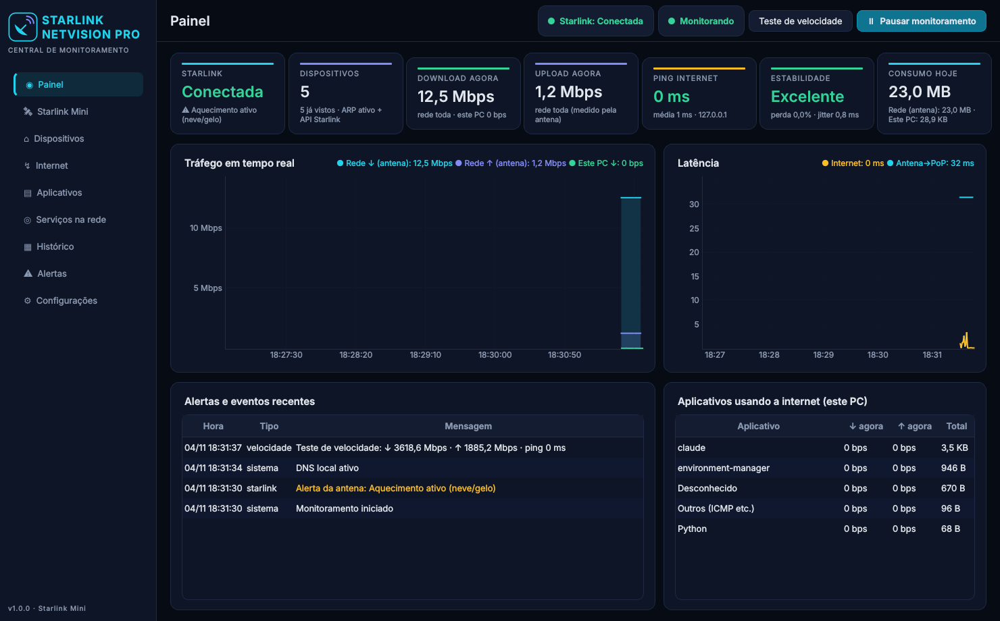

# STARLINK NETVISION PRO

Monitoramento e gerenciamento de rede para **Starlink Mini sem roteador adicional**, no Windows 11.
Interface escura em português, dados reais, sem simulação.

Antes de usar, leia a [análise técnica](docs/ANALISE_TECNICA.md): ela mostra o que vem da Starlink, o que vem do Windows e onde estão as limitações.



## Funcionalidades

| Área | O que faz |
|---|---|
| **Painel** | Status da Starlink, dispositivos online, tráfego atual da rede (antena) e do PC, ping, estabilidade, consumo do dia, alertas e top aplicativos |
| **Starlink Mini** | Estado, firmware, hardware, ping e perda até o PoP, obstrução, GPS, alertas da antena, estatísticas de 15 min e diagnóstico da lista Wi-Fi |
| **Dispositivos** | Lista com nome, IP, MAC, fabricante, banda e sinal (quando a API libera), consumo por aparelho (idem), primeira e última vez visto. Renomear e esquecer |
| **Internet** | Teste de velocidade, ping/jitter/perda em tempo real por destino, gráfico de consumo do PC, histórico de testes |
| **Aplicativos** | Download/upload por programa (Chrome, Steam, CS2, Discord, downloads...) e serviços acessados pelo PC |
| **Serviços na rede** | DNS local opcional para identificar YouTube, TikTok, Instagram, Netflix e jogos em outros aparelhos (estimativa) |
| **Histórico** | Gráficos de 24 h / 7 / 30 dias, tabelas diária e mensal, exportação CSV e relatório HTML |
| **Alertas** | Novo dispositivo, desconexão, mudança de estado da antena, alertas da antena, ping/perda acima do limite |
| **Configurações** | Intervalos, destinos, limites de alerta, inicialização com o Windows, modo bandeja |

Botão **Iniciar/Pausar monitoramento** na barra superior e no menu da bandeja. Fechar a janela mantém o programa na bandeja; para encerrar, use **Sair**.

## Requisitos

1. Windows 11 64 bits, conectado ao Wi-Fi da Starlink Mini.
2. **Npcap** (recomendado, gratuito para uso pessoal): https://npcap.com/#download
   Na instalação, deixe **desmarcada** a opção *"Restrict Npcap driver's access to Administrators only"*. Assim o programa mede consumo por aplicativo sem rodar como administrador.
   Sem o Npcap tudo funciona, exceto: bytes por aplicativo (fica em modo básico) e ARP ativo (o scanner usa ICMP + tabela ARP).

## Opção A: usar o executável

- Gere o `.exe` (opção C) ou baixe o artefato `StarlinkNetVisionPro-windows` da aba **Actions** do GitHub, gerado pelo workflow `NetVision - build Windows (.exe)`.
- Execute `StarlinkNetVisionPro.exe`. Não precisa de instalação nem de administrador.
- O Windows SmartScreen pode avisar por ser um executável sem assinatura digital: **Mais informações → Executar assim mesmo**.

## Opção B: rodar pelo código-fonte

```bat
cd starlink-netvision-pro
py -3 -m venv .venv
.venv\Scripts\activate
pip install -r requirements.txt
python run.py
```

Ou dê duplo clique em `run.bat`.

## Opção C: compilar o .exe

```bat
cd starlink-netvision-pro
build.bat
```

O script cria o ambiente, instala dependências, **roda os testes** e gera `dist\StarlinkNetVisionPro.exe` (arquivo único, cerca de 100 MB).

Comando manual equivalente:

```bat
pip install -r requirements-dev.txt
python -m pytest tests -q
pyinstaller build\netvision.spec --noconfirm
```

## Primeiro uso: checklist

1. Abra o programa conectado ao Wi-Fi da Starlink.
2. **Painel → Starlink** deve mostrar *Conectada*. Se mostrar *Sem comunicação*, confira se `192.168.100.1` responde (página Internet → "Antena (LAN)") e se a Mini não está em modo bypass com outro roteador.
3. Página **Starlink Mini → Roteador integrado** mostra se a lista Wi-Fi da API respondeu e em qual endereço.
4. Página **Dispositivos**: renomeie os aparelhos com MAC privado (celulares) para identificá-los nos alertas.
5. Opcional: **Serviços na rede → Ativar DNS local**, liberar no Firewall e configurar o DNS do celular/TV para o IP do PC.
6. Opcional: **Configurações → Iniciar com o Windows** e **Abrir minimizado na bandeja**.

## Onde ficam os dados

| Item | Local |
|---|---|
| Banco (histórico) | `%APPDATA%\StarlinkNetVisionPro\netvision.sqlite3` |
| Configurações | `%APPDATA%\StarlinkNetVisionPro\config.json` |
| Log | `%APPDATA%\StarlinkNetVisionPro\netvision.log` |
| Relatórios | `Documentos\NetVision Relatorios` |

## Arquitetura

```
netvision/
├── app.py                 inicialização, logging, QApplication
├── engine.py              threads de coleta, agregação por minuto, alertas, sinais Qt
├── core/
│   ├── config.py          configurações (JSON)
│   ├── database.py        SQLite: minutos, dispositivos, eventos, testes, apps, serviços
│   ├── paths.py           pastas de dados e recursos
│   └── winsys.py          admin sob demanda (UAC), firewall, autostart (HKCU)
├── services/
│   ├── starlink.py        API gRPC local (status, histórico, wifi_get_clients) com reflection
│   ├── scanner.py         ARP ativo / ICMP + tabela ARP, nomes (DNS reverso, mDNS, NetBIOS)
│   ├── oui.py             fabricante pelo MAC, MAC privado
│   ├── latency.py         ping ICMP nativo (IcmpSendEcho no Windows), jitter e perda
│   ├── speedtest.py       teste de velocidade HTTP multi-conexão
│   ├── traffic.py         consumo do PC (contadores das placas)
│   ├── appmonitor.py      bytes por processo via Npcap, DNS e SNI
│   ├── classifier.py      domínio → serviço (com confiança) e processo → nome amigável
│   ├── dnsproxy.py        DNS local opcional para outros aparelhos
│   └── reports.py         exportação CSV e HTML
└── ui/                    PySide6 + pyqtgraph (tema, componentes, 9 páginas, bandeja)
tests/                     28 testes, incluindo servidor gRPC Starlink de teste
build/netvision.spec       PyInstaller
```

## Testes

```bat
pip install -r requirements-dev.txt
python -m pytest tests -q
```

`tests/fake_starlink_server.py` sobe um servidor gRPC com os **descritores reais da antena** (pacote `starlink-client`, MIT) e reflection, para validar o cliente pelo mesmo caminho usado com a Mini real. O teste de captura em loopback roda apenas como root no Linux; no Windows ele é ignorado.

## Limitações conhecidas

- A API local da Starlink não é documentada oficialmente; uma atualização de firmware pode remover campos. O programa mostra "-" e registra o erro em vez de inventar valores.
- Consumo por aparelho e nome DHCP dependem do firmware da Mini responder a `wifi_get_clients`.
- Identificação de serviços por DNS/SNI é estimativa.
- A captura por aplicativo roda em Python e pode subcontar alguns pacotes em rajadas muito altas (centenas de Mbps). O total do PC, medido pelos contadores da placa, é exato.
- O histórico só cobre o período em que o programa está aberto (use a inicialização com o Windows).
